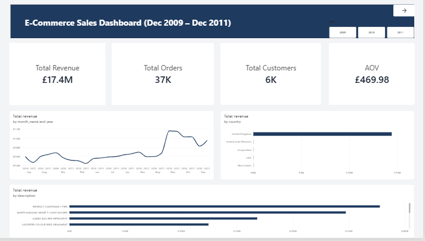
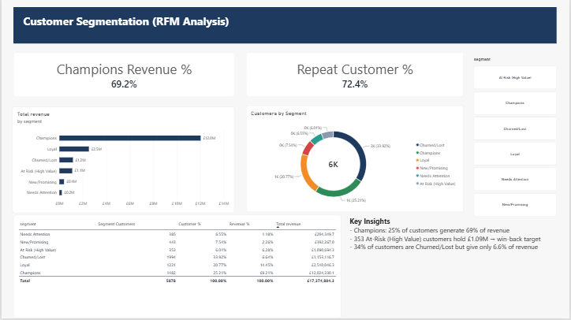

# E-Commerce Customer Segmentation & Sales Analytics

End-to-end analytics project on the UCI **Online Retail II** dataset: data cleaning (Python), storage in a PostgreSQL star schema, RFM customer segmentation, and a 2-page Power BI dashboard.

**Tools:** Python (Pandas), PostgreSQL, Power BI (DAX)

## Business Problem
Which customers generate most of the revenue, which are at risk of leaving, and where should marketing effort go?

## Dataset
- Source: [UCI Online Retail II](https://archive.ics.uci.edu/dataset/502/online+retail+ii)
- UK-based online wholesale gift retailer, Dec 2009 – Dec 2011 (many customers are B2B buyers)
- 1,067,371 raw transaction rows

## Data Cleaning (Python)
| Step | Action |
|---|---|
| Cancelled orders | Removed invoices starting with `C` |
| Missing Customer ID | Dropped rows with null Customer ID |
| Invalid values | Removed quantity <= 0 or price <= 0 |
| Duplicates | Dropped duplicate rows |

**Result: 1,067,371 → 779,425 rows**, `Revenue = Quantity x Price` added.

## Database (PostgreSQL)
Star schema loaded from the cleaned CSVs:
- `fact_sales` (779,425 rows)
- `dim_customer` (5,878 customers, with RFM scores and segment)
- `dim_product` (4,631 products)
- `dim_date`

Full script: [`postgres_setup.sql`](postgres_setup.sql)

## RFM Segmentation
Each customer scored 1-5 on Recency, Frequency and Monetary value, then grouped into 6 segments.

| Segment | Customers | % Customers | % Revenue |
|---|---|---|---|
| Champions | 1,482 | 25.2% | 69.2% |
| Loyal | 1,221 | 20.8% | 14.4% |
| Churned/Lost | 1,994 | 33.9% | 6.6% |
| At Risk (High Value) | 353 | 6.0% | 6.3% |
| New/Promising | 443 | 7.5% | 2.3% |
| Needs Attention | 385 | 6.5% | 1.2% |

## Key Numbers
- Total revenue: **£17.37M** | Orders: **36,969** | Customers: **5,878** | AOV: **~£470**

## Dashboard (Power BI)
**Page 1: Sales Overview**


**Page 2: Customer Segments (RFM)**


## Insights & Recommendations
1. **Champions (25% of customers) generate 69% of revenue.** Protect them with loyalty rewards and early access.
2. **353 At-Risk (High Value) customers hold £1.09M in lifetime revenue.** Best target for a personalised win-back campaign, since the group is small and was previously high-spending.
3. **34% of customers are Churned/Lost but contribute only 6.6% of revenue.** Reduce marketing spend here.

## Limitations
- Monetary is total spend, so a high revenue share for top segments is partly expected.
- Data is from 2009-2011 and from a wholesale business, so results may not generalise to modern B2C e-commerce.
- Non-product entries (e.g. Manual, POSTAGE) were excluded from product analysis.
- This is descriptive analysis; no campaign was run, so no churn reduction is claimed.

## Repository Structure
```
├── README.md
├── notebook/Data_Ecom_Analytics.ipynb
├── sql/postgres_setup.sql
├── data/rfm_segments.csv
├── powerbi/E_Commerce_Analytics.pbix
├── powerbi/ecom_theme.json
└── images/
```

## How to Reproduce
1. Download the dataset from UCI and save the two sheets as CSV
2. Run the notebook to produce `clean_retail.csv` and `rfm_segments.csv`
3. Run `sql/postgres_setup.sql` and import both CSVs into the staging tables
4. Open the `.pbix` in Power BI Desktop and refresh from your PostgreSQL database
